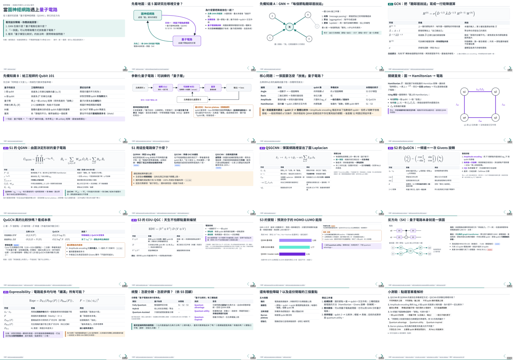
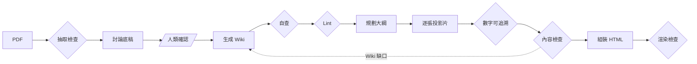

# 圖神經網路 × 量子電路：LLM Wiki 與教學簡報

生成式 AI 課程第 10 週作業：先建立一個主題的 **LLM Wiki**，再以 Wiki 為唯一知識來源，製作一份**教學型 HTML 簡報**，並說明與反思整個 loop／graph 的設計。

| 成果 | 連結 |
|---|---|
| 📚 LLM Wiki | [`wiki/index.md`](wiki/index.md)（建議從 [`wiki/overview.md`](wiki/overview.md) 開始） |
| 🖥️ 教學簡報 | https://joeyhuang329.github.io/genai_course_works_w10/slides/（原始檔 [`slides/index.html`](slides/index.html)） |
| 🔁 Loop／Graph 設計 | [`docs/workflow.md`](docs/workflow.md) |
| 🧾 實際執行紀錄 | [`docs/run-log.md`](docs/run-log.md) |
| 🤔 反思 | [`docs/reflection.md`](docs/reflection.md) |
| 🔗 投影片 ↔ Wiki 對照 | [`docs/traceability.md`](docs/traceability.md) |



## 主題

五篇文獻都落在「量子計算」、「圖神經網路」與「量子電路」的交集：

| 代號 | 文獻 | 一句話 |
|---|---|---|
| S1 | Verdon et al., *Quantum Graph Neural Networks*, arXiv 2019 | 讓圖決定量子子系統之間的交互作用 |
| S2 | Hu et al., *On the Design of Quantum Graph Convolutional Neural Network…*, IEEE ICCD 2022 | 用 Givens 旋轉把鄰接矩陣放進量子電路 |
| S3 | Ryu, Elala, Rhee, *Quantum Graph Neural Network Models for Materials Search*, Materials 2023 | 用對稱的雙 qubit 閘預測分子能隙 |
| S4 | Aktar et al., *Graph Neural Networks for PQC Expressibility Estimation*, arXiv 2024 | 把量子電路當成圖，用 GNN 預測表達能力 |
| S5 | Ceschini et al., *From graphs to qubits: a critical review of QGNNs*, Neural Comput. Appl. 2026 | 分類法、utility vs. advantage、五大挑戰 |

完整書目與 DOI／arXiv 連結見 [`raw/sources.md`](raw/sources.md)。依裁決 D3，PDF 不放進公開 repo。

## Repo 結構

```
.
├── CLAUDE.md              Wiki schema：頁面格式、證據等級、ingest/query/lint/slides 流程（v2）
├── raw/sources.md         原始資料書目（不含 PDF）
├── wiki/                  LLM Wiki（27 頁）
│   ├── index.md           內容地圖
│   ├── overview.md        一頁總覽
│   ├── glossary.md        名詞表
│   ├── log.md             維護紀錄（時間序）
│   ├── sources/           5 篇文獻頁
│   ├── concepts/          12 個概念頁
│   ├── models/            5 個模型頁
│   └── syntheses/         跨文獻比較
├── slides/index.html      20 張 reveal.js 教學簡報
├── tools/
│   ├── check.py           Wiki lint＋投影片檢查（斷鏈、證據標記、data-wiki、公式數、誇大用詞）
│   ├── traceability.py    投影片數字是否能在對應 Wiki 頁找到；產生對照表
│   └── render_check.py    headless Chrome 逐張截圖、量測是否超出畫面
└── docs/
    ├── planning/          規劃文件（01 提案、02 待裁決、03 討論底稿、04 裁決結果）
    ├── workflow.md        loop／graph 設計
    ├── run-log.md         實際執行紀錄（37 筆問題）
    ├── reflection.md      反思
    ├── traceability.md    投影片 ↔ Wiki ↔ 文獻 對照表
    ├── submission-draft.md 繳交區文字草稿
    ├── check-reports/     每次 lint 的輸出
    └── render-check/      最終截圖與渲染報告
```

## 流程一覽



詳見 [`docs/workflow.md`](docs/workflow.md)。

## 自己跑檢查

```bash
python3 tools/check.py all             # Wiki lint + 投影片檢查（--report 會存報告到 docs/check-reports/）
python3 tools/traceability.py --write  # 產生 docs/traceability.md

# 渲染檢查需要 playwright 與 Chrome；若連不到 CDN，可先 npm 安裝同版本套件，再用 --local-npm 指向該資料夾
pip install playwright
npm i --prefix /tmp/npm reveal.js@5.1.0 katex@0.16.11
python3 tools/render_check.py --local-npm /tmp/npm
```

`render_check.py` 預設使用 `/usr/bin/google-chrome`；在 Windows 或 macOS 上執行時，請改腳本中的 `executable_path`，或改用 `playwright install chromium`。

## 部署

1. 把 repo 推到 GitHub（PowerShell 指令見交付訊息，或參考下方）。
2. GitHub repo → **Settings → Pages** → Source 選 **Deploy from a branch**，Branch 選 `main`、資料夾選 `/ (root)` → Save。
3. 約 1 分鐘後，簡報網址為 `https://joeyhuang329.github.io/genai_course_works_w10/slides/`。

repo 根目錄有 `.nojekyll`，讓 GitHub Pages 原樣提供檔案，不經 Jekyll 處理。

```powershell
# 在解壓後的資料夾中執行
git init
git add .
git commit -m "LLM Wiki 與教學簡報：圖神經網路 × 量子電路"
git branch -M main
git remote add origin https://github.com/JoeyHuang329/genai_course_works_w10.git
git push -u origin main
```

## 生成式 AI 的職責範圍

本作業由 **Claude（Anthropic）** 在 Claude 對話中執行，課程作者負責選題、提供文獻、裁決與審閱。分工細節見 [`docs/submission-draft.md`](docs/submission-draft.md#附ai-使用分工的事實清單供作者撰寫聲明參考)，正式聲明由作者在繳交區撰寫。

| Claude | 課程作者 |
|---|---|
| 讀文獻、寫規劃與討論底稿 | 選主題、選 5 篇文獻 |
| 撰寫 `CLAUDE.md`、檢查腳本、27 頁 Wiki、20 張簡報 | 裁決所有待決事項（`docs/planning/04`） |
| 執行檢查、修正、撰寫執行紀錄與反思 | 審閱、推送、繳交 |

5 篇論文的研究成果屬於各論文作者；本 repo 是教學性的整理與改寫。
