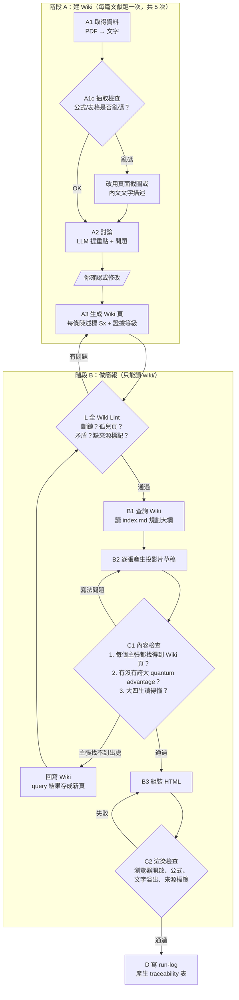

> 📌 **歷史文件（2026-11-21 撰寫，執行前的規劃）**：保留原貌作為「討論回合」的紀錄，實際做法以 [`CLAUDE.md`](../../CLAUDE.md) 與 [`docs/workflow.md`](../workflow.md) 為準。其中與實際不同之處（例如 S2 的分類、S4 的雜訊資料、簡報張數）見 [`docs/run-log.md`](../run-log.md)。

# 01｜專案提案與實作規劃：用 LLM Wiki 製作「量子圖神經網路（QGNN）是什麼？」教學 HTML 簡報

> 文件性質：提案 + 實作步驟 + 繳交內容撰寫規劃
> 撰寫者：Claude（生成式 AI），內容需由修課學生審閱、裁決（見 `02_待裁決事項.md`）後才定案
> 目標讀者：修課學生本人（資工系大四程度）

---

## 0. 一句話提案

把 5 篇 QGNN 文獻放進 `raw/`，用「先討論、後生成」的方式讓 LLM 編成一個約 20 頁的 Markdown Wiki；再讓 LLM **只能查 Wiki**（不能直接讀 PDF）來產生一份約 16 頁的 reveal.js 教學簡報；每張投影片都標註它引用的 Wiki 頁面，最後用一次實際執行的檢查紀錄寫反思。

---

## 1. 作業規範理解（逐條對照）

### 1.1 四個步驟的要求與本專案的對應

| 作業步驟 | 規範要求 | 本專案怎麼做 | 產出物 |
|---|---|---|---|
| 步驟一 | 建立自選主題的 LLM Wiki | 主題：Quantum Graph Neural Networks 入門 | `wiki/` 資料夾 |
| 步驟一 | 「先討論、後生成」 | 每篇文獻 ingest 時先產生**討論底稿**（重點 + 待確認問題），由你回覆確認後才寫入 Wiki | `wiki/log.md` 中每筆 ingest 都有「討論」與「生成」兩段 |
| 步驟一 | 至少 ingest 5 篇 | 剛好 5 篇（見 §2） | `wiki/sources/` 5 頁 |
| 步驟二 | AI 以 Wiki 為知識來源做教學 HTML 簡報 | 產生簡報的階段**禁止讀 `raw/`**，只能讀 `wiki/` | `slides/index.html` |
| 步驟二 | 讓不熟悉主題的人理解基本概念 | 簡報從「圖是什麼、GNN 在做什麼、qubit 是什麼」開始，最後才講 QGNN 的限制 | 教學結構見 §4 |
| 步驟三 | 說明 loop / graph 設計：哪些重複、哪些檢查/重生、為什麼 | Mermaid 流程圖 + 三個迴圈的說明 | `docs/workflow.md` |
| 步驟四 | 一次實際執行後反思（最常出錯節點、檢查前移到哪、是否改 graph） | 執行紀錄表 + 反思三題 | `docs/run-log.md`、`docs/reflection.md` |

### 1.2 繳交內容 1–6 的對照

| # | 繳交項目 | 來源檔案 | 備註 |
|---|---|---|---|
| 1 | LLM Wiki 主題與簡短介紹 | `README.md` 開頭 | 3–5 句即可 |
| 2 | LLM Wiki 連結或成果 | GitHub repo 的 `wiki/` 連結 | 或附 zip，見裁決事項 D2 |
| 3 | 教學 HTML 簡報連結 | GitHub Pages 網址 | 須能「實際瀏覽」，交之前用無痕視窗開一次 |
| 4 | loop / graph 流程圖或文字說明 | `docs/workflow.md` | Mermaid 圖 + 文字 |
| 5 | 一次實際執行的結果或檢查紀錄 | `docs/run-log.md` | **必須是真的跑過的紀錄**，不可以由 AI 事先編寫 |
| 6 | 反思 | `docs/reflection.md` | 三題都要答 |

### 1.3 評分標準拆解：怎麼拿 9–10 分

9–10 分的五個附加條件，以及本專案對應的「證據」：

| 9–10 分條件 | 本專案的證據（評分者看得到的東西） |
|---|---|
| Wiki 資料與簡報內容有明確對應 | 每張投影片右下角顯示 `來源：[[concepts/barren-plateau]]` 之類的標籤；`docs/traceability.md` 有「投影片 → Wiki 頁 → 原始文獻」對照表 |
| loop / graph 設計合理且說明清楚 | 流程圖中每個節點都有輸入、輸出、檢查條件；三個迴圈都寫明重複次數上限 |
| 有實際執行與檢查紀錄 | `run-log.md` 裡有時間戳、哪個節點失敗、失敗原因、怎麼修 |
| 能反思哪個節點容易出錯、如何提前檢查 | `reflection.md` 寫出「把哪一項檢查從哪個節點移到哪個節點」，並附修改前後的流程圖 |
| 簡報具有清楚的教學結構 | 學習目標 → 先備知識 → 核心概念 → 實例 → 限制 → 小測驗 → 總結 |

### 1.4 抄襲條款的理解（最重要）

註一說明「抄襲」在這門課指的是**沒有如實聲明生成式 AI 的職責範圍**。所以：

- 在 `README.md` 和繳交內文都放一段「AI 使用聲明」（範本見 §7）。
- `run-log.md` 與 `reflection.md` 的內容必須以你實際操作的觀察為主。AI 可以幫忙排版、整理，但「哪個節點出錯」必須是真的發生過的事。
- 這三份規劃文件本身也是 AI 產出，聲明裡要寫到。

---

## 2. 主題與 5 篇文獻

**Wiki 主題**：Quantum Graph Neural Networks（QGNN）— 把「圖神經網路」和「量子電路」結合的研究方向。

| 代號 | 文獻 | 在 Wiki 裡的角色 |
|---|---|---|
| S1 | Verdon et al., *Quantum Graph Neural Networks*, arXiv:1909.12264 (2019) | **起源**：第一個 QGNN 通用 ansatz；QGRNN / QGCNN / QSGCNN |
| S2 | Hu et al., *On the Design of Quantum Graph Convolutional Neural Network in the NISQ-Era and Beyond*, IEEE ICCD 2022 | **具體電路**：用 Givens rotation 把鄰接矩陣放進量子電路（QuGCN） |
| S3 | Ryu, Elala, Rhee, *Quantum Graph Neural Network Models for Materials Search*, Materials 16:4300 (2023) | **應用實驗**：EDU-QGC 預測分子 HOMO-LUMO gap（QM9） |
| S4 | Aktar et al., *Graph Neural Networks for Parameterized Quantum Circuits Expressibility Estimation*, arXiv:2405.08100 (2024) | **反方向對照**：用「古典」GNN 去分析量子電路（不是 QGNN，但很好的教學對照） |
| S5 | Ceschini et al., *From graphs to qubits: a critical review of quantum graph neural networks*, Neural Computing and Applications 38:731 (2026) | **總綱與批判**：分類法、編碼成本、quantum advantage vs. utility、挑戰 |

這 5 篇剛好形成一條教學故事線：**S5 給地圖 → S1 給起源 → S2、S3 給兩種具體做法 → S4 給反向對照 → S5 回來談限制**。

---

## 3. LLM Wiki 設計（依 Karpathy 的 LLM Wiki 模式）

### 3.1 三層結構

Karpathy 的 LLM Wiki 模式分成三層：不可修改的原始資料、由 LLM 撰寫維護的 Wiki，以及一份告訴 LLM 規則的 schema 檔（Claude Code 用 `CLAUDE.md`，Codex 用 `AGENTS.md`）。三個核心操作是 **ingest、query、lint**。本專案直接照用，不加額外機制。

```
qgnn-llm-wiki/
├── CLAUDE.md                 # schema：Wiki 規則、頁面模板、三種操作的步驟
├── README.md                 # 主題介紹 + AI 使用聲明 + 連結
├── raw/                      # 原始文獻（不上傳 PDF，只放書目與連結，見裁決 D3）
│   └── sources.md
├── wiki/
│   ├── index.md              # 內容地圖（LLM 查詢時先讀這頁）
│   ├── log.md                # 時間序紀錄：## [2026-11-22 10:05] ingest | S1 ...
│   ├── overview.md           # 一頁總覽：QGNN 是什麼、為什麼、現況
│   ├── glossary.md           # 名詞表（中英對照）
│   ├── sources/              # 每篇文獻一頁（5 頁）
│   │   ├── S1-verdon-2019.md
│   │   └── ...
│   ├── concepts/             # 概念頁（約 10 頁）
│   │   ├── graph-and-gnn.md            # 圖、鄰接矩陣、message passing、GCN
│   │   ├── qubit-basics.md             # qubit、疊加、糾纏、量測
│   │   ├── pqc-and-vqa.md              # 參數化量子電路、混合訓練迴圈
│   │   ├── data-encoding.md            # angle / amplitude / basis / Hamiltonian
│   │   ├── barren-plateau.md
│   │   ├── expressibility.md
│   │   ├── permutation-equivariance.md # 含 1-WL
│   │   ├── qgnn-taxonomy.md            # Fully / Hybrid / Quantum-assisted
│   │   └── advantage-vs-utility.md
│   └── models/               # 模型頁（約 5 頁）
│       ├── qgnn-verdon-family.md       # QGRNN / QGCNN / QSGCNN
│       ├── qugcn-givens.md
│       ├── edu-qgc.md
│       └── gnn-for-pqc.md
├── slides/
│   └── index.html            # reveal.js 單檔簡報
└── docs/
    ├── workflow.md           # loop/graph 設計
    ├── run-log.md            # 實際執行紀錄
    ├── traceability.md       # 投影片 ↔ Wiki ↔ 文獻對照
    └── reflection.md
```

### 3.2 頁面模板（寫進 `CLAUDE.md`）

每一頁 Wiki 都使用同一個 frontmatter，讓檢查節點可以用程式判斷：

```markdown
---
title: Barren Plateau（貧瘠高原）
type: concept            # source | concept | model | overview
sources: [S5, S1, S3]    # 這頁的內容出自哪些文獻
difficulty: 2            # 1=大一能懂 2=大三 3=研究生
updated: 2026-11-22
---

## 一句話
## 直觀解釋
## 稍微正式一點
## 在 QGNN 裡為什麼重要
## 文獻怎麼說
- [S5] ……（證據等級：理論 / 實驗 / 作者宣稱）
## 相關頁面
[[pqc-and-vqa]] · [[expressibility]]
```

**關鍵規則**：「文獻怎麼說」區塊裡每一條陳述都要標 `[Sx]` 和證據等級。這一條是後面反思「把檢查前移」的伏筆（見 §6.3）。

### 3.3 「先討論、後生成」的具體做法

每篇文獻的 ingest 都拆成兩回合：

1. **討論回合**（LLM → 你）：LLM 讀完文獻，輸出
   - 3–5 個主要重點（takeaways）
   - 準備新建或更新的 Wiki 頁清單
   - 2–3 個需要你決定的問題（例如：「這篇的 exponential speedup 要不要照作者原話寫？」）
2. **你回覆**：確認、刪改、回答問題（幾句話即可）
3. **生成回合**（LLM 寫入）：寫 `sources/Sx.md`、更新相關 concept/model 頁、更新 `index.md`、在 `log.md` 追加一筆

`log.md` 的每筆紀錄格式固定（方便之後 `grep`）：

```markdown
## [2026-11-22 10:05] ingest | S1 Verdon 2019
- 討論：LLM 提出 4 個重點；我刪掉「QSGCNN 細節」（太難），保留其餘
- 生成：新增 sources/S1、models/qgnn-verdon-family；更新 concepts/graph-and-gnn
- 問題：PDF 公式抽取亂碼 → 以論文內文字描述為準
```

`03_文獻梳理與討論底稿.md` 就是這 5 次「討論回合」的初稿，可以直接拿來用。

---

## 4. 教學 HTML 簡報規劃

### 4.1 技術選擇（預設，可在裁決事項改）

- **reveal.js（CDN 載入）+ KaTeX**，單一 `index.html`，放 GitHub Pages。
- 每張投影片的 `<section>` 加上 `data-wiki="concepts/barren-plateau"` 屬性，並在畫面角落顯示來源標籤；這讓「Wiki 與簡報有明確對應」變成**看得見、可用程式檢查**。
- 投影片內容用中文，專有名詞第一次出現時附英文。

### 4.2 教學結構（16 張，約 15 分鐘）

| # | 投影片 | 教學目的 | 對應 Wiki 頁 |
|---|---|---|---|
| 1 | 標題 + 學習目標（看完能回答 3 個問題） | 設定期望 | overview |
| 2 | 為什麼要把「圖」和「量子」放一起？ | 動機 | overview, S5 |
| 3 | 圖與 GNN：鄰居傳訊息（message passing） | 先備知識 A | concepts/graph-and-gnn |
| 4 | GCN 一行公式：$H' = \sigma(\hat{A} H W)$ 的直觀意義 | 先備知識 A | concepts/graph-and-gnn |
| 5 | Qubit 101：疊加、糾纏、量測（不講線代細節） | 先備知識 B | concepts/qubit-basics |
| 6 | 參數化量子電路 = 可訓練的「量子層」；混合訓練迴圈 | 先備知識 B | concepts/pqc-and-vqa |
| 7 | 核心問題：圖要怎麼放進量子電路？四種編碼 | 核心概念 | concepts/data-encoding |
| 8 | 做法一：讓圖決定「誰跟誰交互作用」（Verdon 2019） | 核心概念 | models/qgnn-verdon-family |
| 9 | 做法二：用 Givens rotation 模擬鄰接矩陣（QuGCN） | 核心概念 | models/qugcn-givens |
| 10 | 做法三：保持對稱性的電路（EDU-QGC）＋分子實驗 | 實例 | models/edu-qgc, S3 |
| 11 | 對照：反過來用 GNN 分析量子電路（不是 QGNN！） | 釐清誤解 | models/gnn-for-pqc |
| 12 | 分類地圖：Fully / Hybrid / Quantum-assisted | 統整 | concepts/qgnn-taxonomy |
| 13 | 冷靜一下：quantum advantage ≠ quantum utility | 批判思考 | concepts/advantage-vs-utility |
| 14 | 三大障礙：雜訊、可擴展性、barren plateau | 限制 | concepts/barren-plateau, S5 |
| 15 | 小測驗（3 題選擇題，點擊顯示答案） | 檢核學習 | 全部 |
| 16 | 總結 + 參考文獻 + AI 使用聲明 | 收尾 | sources/* |

---

## 5. Loop / Graph 設計（步驟三的內容）

### 5.1 流程圖（預計放進 `docs/workflow.md`）



### 5.2 三個問題的回答（草稿）

**哪些步驟會重複執行？**

| 迴圈 | 範圍 | 次數 | 原因 |
|---|---|---|---|
| Ingest 迴圈 | A1 → A3 | 每篇文獻 1 次，共 5 次 | LLM Wiki 的累積特性：後面的文獻會更新前面建立的概念頁 |
| Lint 修正迴圈 | A3 ↔ L | 至多 2 輪 | 5 篇文獻術語不一致（例如 QGCNN vs QuGCN）需要合併或區分 |
| 投影片迴圈 | B2 ↔ C1 | 每張至多 2 次重生，超過就人工介入 | 防止無限重生；第 3 次失敗通常代表 Wiki 本身有缺口 |
| 回寫迴圈 | C1 → GAP → L | 視需要 | 簡報需要但 Wiki 沒有的知識要先補進 Wiki，而不是讓 LLM 直接編 |

**哪些地方需要檢查或重新生成？**

- **A1c**：PDF 抽取（已實際觀察到公式亂碼，見 03 文件 §0）
- **L**：Wiki 層級的一致性
- **C1**：簡報內容層級的正確性與可讀性（最重要）
- **C2**：HTML 呈現層級

**為什麼這樣設計？**

1. **簡報階段只能讀 Wiki**：確保簡報內容的每一句都能追溯到 Wiki，這是作業的核心要求，也讓 C1 的「找得到出處嗎？」有明確答案。
2. **把 Wiki 缺口回寫成 Wiki 頁，而不是讓 LLM 直接寫進簡報**：這是 LLM Wiki 和 RAG 的差別：知識會累積，下次查詢可以直接用。
3. **檢查分三層（抽取 / Wiki / 簡報）**：錯誤越早抓到，修正成本越低。錯誤到了簡報才發現，就要往回追三層。
4. **重生次數設上限**：避免 LLM 在同一個錯誤上空轉。

---

## 6. 實際執行與反思的規劃（步驟四）

### 6.1 執行紀錄格式（`docs/run-log.md`）

| 時間 | 節點 | 輸入 | 結果 | 問題描述 | 處理方式 | 重試次數 |
|---|---|---|---|---|---|---|
| 11/22 10:05 | A1c | S5 PDF | ❌ | 中文字型缺失警告，部分表格錯位 | 改看該頁截圖 | 1 |
| … | … | … | … | … | … | … |

最後附統計：各節點失敗次數長條圖（手算即可）。

### 6.2 可預期的出錯點（這是**預測**，不是紀錄）

根據我讀這 5 篇時實際遇到的狀況，以下節點**很可能**出錯，但實際結果以你跑出來的為準：

| 節點 | 可能的錯誤 | 依據 |
|---|---|---|
| A1c | 公式抽成亂碼（例如 $\tilde{D}^{-1/2}\tilde{A}\tilde{D}^{-1/2}$ 被拆成好幾行） | 我用 `pdftotext` 抽取 S1、S2 時實際發生 |
| A3 | 把 S4 歸類成「QGNN」 | S4 是古典 GNN 分析量子電路，標題容易誤導 |
| C1 | 誇大宣稱：寫成「QGNN 比 GNN 快指數倍」 | S2 摘要寫了 exponential，但它自己的表格顯示有 $\log^2 N$ 的額外成本；S5 明確區分 advantage 與 utility |
| C1 | 寫成「QGNN 在分子預測上打敗古典模型」 | S3 摘要說在參數量相近時 test loss 較低，但同文也承認 SOTA 古典模型 ALIGNN 誤差約低 10 倍 |

### 6.3 反思的預期方向（等真的跑完再寫）

若實際執行後最常出錯的是 **C1（誇大宣稱）**，合理的調整是：

> 把「證據等級 / advantage vs. utility」檢查從 **C1（簡報階段）前移到 A3（寫 Wiki 階段）**：每條陳述寫入 Wiki 時就必須標 `[理論]`、`[模擬實驗]`、`[作者宣稱]`，並在 `advantage-vs-utility.md` 定義用詞。這樣 B2 產生投影片時，LLM 讀到的 Wiki 已經帶有限定詞，誇大就不容易發生。

這也是為什麼 §3.2 的模板一開始就放了證據等級欄位。反思時可以誠實寫：「這個欄位是第一次執行後才加的」或「一開始就預留，執行後確認有效」。**請照實際情況寫，不要兩種都寫。**

---

## 7. AI 使用聲明範本（放在 README 與繳交內文）

> **生成式 AI 使用聲明**
> 本作業使用 Claude（Anthropic，Opus 5.5）協助，職責範圍如下：
> 1. **規劃**：專案規劃、流程設計初稿、待裁決事項清單由 Claude 撰寫，經本人審閱與裁決後採用。
> 2. **Wiki 撰寫**：Wiki 頁面由 LLM 依「先討論、後生成」流程撰寫；每篇文獻的重點由 LLM 提出，經本人確認或修改後才寫入（紀錄於 `wiki/log.md`）。
> 3. **簡報**：HTML 簡報由 LLM 依 Wiki 內容生成，本人負責檢查與要求修正。
> 4. **本人負責**：選定主題與文獻、所有裁決、執行流程、檢查紀錄、反思內容。
> 5. 原始文獻的研究成果屬於各論文作者，本作業僅做教學性整理。

（請依實際使用的工具與分工修改，例如若 Wiki 是用 Claude Code 或其他工具生成，要寫出來。）

---

## 8. 明天交件的時程（約 5–6 小時）

| 時段 | 工作 | 產出 | 完成判準 |
|---|---|---|---|
| 0:00–0:30 | 裁決 `02` 的事項；建 repo 與 `CLAUDE.md` | repo 骨架 | `CLAUDE.md` 有模板與三種操作規則 |
| 0:30–2:00 | 5 次 ingest（用 `03` 當討論底稿，每篇約 15 分鐘） | `wiki/` 約 20 頁 | `log.md` 有 5 筆含「討論」的紀錄 |
| 2:00–2:20 | Lint 1–2 輪 | 修正紀錄 | 沒有斷鏈、每頁都有 `sources` |
| 2:20–3:50 | 簡報：大綱 → 逐張 → 檢查 → 組裝 | `slides/index.html` | 16 張都有 `data-wiki`；手機也能開 |
| 3:50–4:20 | GitHub Pages 部署、無痕視窗測試 | 簡報連結 | 別人點得開 |
| 4:20–5:30 | 寫 `run-log`、`traceability`、`reflection`、`workflow` | `docs/` | 6 項繳交內容都齊 |
| 5:30–6:00 | 寫繳交內文、檢查標題格式與 AI 聲明 | 繳交文字 | 對照 §1.2 打勾 |

**繳交標題格式**：`學校簡稱 學號 系級簡稱 姓名 QGNN 教學簡報`
例：`○○大 B11xxxxxx 資工四 王小明 QGNN 教學簡報`

---

## 9. 繳交內文骨架（明天直接填）

```markdown
# ○○大 B11xxxxxx 資工四 王小明 QGNN 教學簡報

## 1. LLM Wiki 主題與簡介
主題：Quantum Graph Neural Networks（量子圖神經網路）入門。
本 Wiki 整理 5 篇文獻（2019–2026），從 QGNN 的起源、兩種具體電路設計、
一個分子性質預測實驗、一個「反向」用 GNN 分析量子電路的研究，到 2026 年的批判性回顧……

## 2. LLM Wiki 連結
https://github.com/<帳號>/qgnn-llm-wiki/tree/main/wiki

## 3. 教學 HTML 簡報連結
https://<帳號>.github.io/qgnn-llm-wiki/slides/

## 4. Loop / Graph 設計
（貼 Mermaid 圖或截圖 + §5.2 三個問題的回答）

## 5. 實際執行紀錄
（貼 run-log 表格摘要 + 連結）

## 6. 反思
- 最常出錯的節點：……（附次數）
- 檢查前移到：……
- 是否修改 graph：……（附修改前後差異）

## AI 使用聲明
（§7）
```
