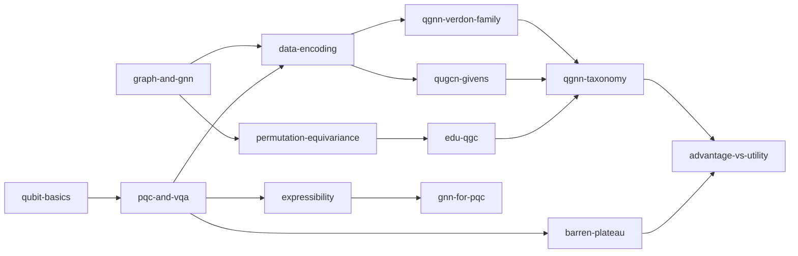

> 📌 **歷史文件（2026-11-21 撰寫，執行前的規劃）**：保留原貌作為「討論回合」的紀錄，實際做法以 [`CLAUDE.md`](../../CLAUDE.md) 與 [`docs/workflow.md`](../workflow.md) 為準。其中與實際不同之處（例如 S2 的分類、S4 的雜訊資料、簡報張數）見 [`docs/run-log.md`](../run-log.md)。

# 03｜文獻梳理與討論底稿（Ingest 討論回合用）

> 用途：這份是 5 次 ingest 的「**討論回合**」初稿。每篇最後都有「待你確認」的問題，你回覆後才進入「生成回合」寫進 Wiki，符合作業要求的「先討論、後生成」。
> 難度：資工系大四。假設你懂線性代數、機器學習與基本 GNN，但沒學過量子計算。
> 撰寫者：Claude，依 5 篇上傳的 PDF 整理；內容為改寫與摘要，數字已對照原文。

---

## 0. 本次讀取時的實際觀察（可作為 run-log 的第一筆真實紀錄）

我（Claude）在 2026-11-21 用 `pdftotext` 抽取這 5 份 PDF 時，實際遇到以下狀況：

| 文獻 | 頁數 | 狀況 |
|---|---|---|
| S5 Review | 40 | 抽取時出現多筆 `Missing language pack for 'Adobe-GB1'`、`Unknown font tag` 警告；文字大致可讀，但表格欄位會錯位 |
| S1 Verdon | 10 | 數學式被拆散（上下標、求和符號跑到別行），Figure 內的數字標籤重複出現上百次 |
| S2 ICCD | 8 | 雙欄排版造成左右欄文字交錯，Givens 矩陣變成難以辨識的碎片 |
| S3 Materials | 26 | 部分段落重複出現（行號混入），表格數值需對照上下文才能判讀 |
| S4 Aktar | 16 | 品質最好，但流程圖文字散落在內文中 |

**結論**：「PDF → 文字」這個節點對數學密集的論文很不可靠。這是支持流程圖中 **A1c 抽取檢查** 節點存在的實際依據。正式執行時，你可以再記一次自己遇到的狀況。

---

## 1. 先備知識速成（Wiki 的 concept 頁初稿）

### 1.1 GNN 的核心：message passing

一張圖 $G=(V,E)$，每個節點有特徵向量。GNN 每一層做的事：**每個節點收集鄰居的特徵 → 彙總 → 更新自己**。Kipf & Welling 的 GCN 把它寫成：

$$H^{(l+1)} = \sigma\!\left(\tilde{D}^{-1/2}\tilde{A}\tilde{D}^{-1/2}\, H^{(l)} W^{(l)}\right)$$

- $\tilde{A}=A+I$：鄰接矩陣加上自環（自己也算自己的鄰居）
- $\tilde{D}^{-1/2}\tilde{A}\tilde{D}^{-1/2}$：正規化，避免鄰居多的節點數值爆掉
- $W$：可訓練權重，所有節點共用

**兩個關鍵性質**，之後量子版本都會想保留：
1. **排列等變性（permutation equivariance）**：節點重新編號，輸出只會跟著重新編號，不會改變內容。
2. **權重共享**：同一層的 $W$ 對所有節點一樣（就像 CNN 的 kernel 在影像上滑動）。

**古典 GNN 的痛點**（S5 整理）：大圖的計算與記憶體成本高；層數一多會 **over-smoothing**（所有節點表示變得一樣）。

### 1.2 Qubit 速成（給資工生的版本）

| 量子概念 | 資工生的類比 | 注意 |
|---|---|---|
| 1 個 qubit 的狀態 $a\|0\rangle+b\|1\rangle$，$\|a\|^2+\|b\|^2=1$ | 長度為 2 的單位複數向量 | 不是「同時是 0 和 1」這麼簡單 |
| $n$ 個 qubit 的狀態 | 長度 $2^n$ 的單位向量 | 這就是「指數級空間」的來源 |
| 量子閘（gate） | 對這個向量乘上一個 **unitary 矩陣**（保長度的旋轉） | 所以量子計算本質上是**線性**的 |
| 參數化閘 $R_Y(\theta)$ | 一個 2×2 旋轉矩陣，$\theta$ 可訓練 | 就像神經網路的權重 |
| 糾纏（entanglement） | 向量無法拆成各 qubit 向量的張量積 | 用 CNOT 等雙 qubit 閘產生 |
| 量測 | 以 $\|振幅\|^2$ 的機率抽樣；要估期望值得重複跑很多次（shots） | **讀出成本**常被忽略 |

### 1.3 參數化量子電路（PQC）與混合訓練

PQC 也叫 VQC 或 QNN，由三段組成：**編碼** $U_\phi(x)$ → **可訓練 ansatz** $U(\theta)$ → **量測**。量測結果算 loss，交給**古典最佳化器**更新 $\theta$，再回量子電路跑。這個「量子算前向、古典算更新」的迴圈就是 VQA（變分量子演算法），也是 NISQ（含雜訊的中等規模量子電腦）時代的主流做法。

梯度可以用 **parameter-shift rule** 在量子硬體上估計（S5 附錄 B 有說明），S1 則是用有限差分。

### 1.4 為什麼不能直接把 GNN 搬上量子電腦？兩個根本難題

1. **非線性**：量子閘是線性的（unitary），但 GNN 的 $\sigma$（ReLU）是非線性的。常見解法：靠量測引入非線性、用 data re-uploading、或像 S1 的 QSGCNN 用非二次的 Hamiltonian。
2. **資料載入**：古典的圖要先編碼成量子態。S5 比較了四種編碼：

| 編碼 | 做法 | qubit 數 | 代價 |
|---|---|---|---|
| Angle | 每個特徵 → 一個旋轉角 | $O(d)$ | 硬體友善，最常用 |
| Basis | 二進位資料 → 計算基底態 | 多 | 適合類別特徵 |
| Amplitude | $d$ 維向量正規化後當振幅 | $O(\log d)$ | **一般狀況下準備這個態需要 $O(d)$ 個操作**，qubit 省了不代表整體就快 |
| Hamiltonian | 圖的邊直接變成 qubit 間的交互作用項 | $O(\|V\|)$ | 對 QGNN 最自然；每層約 $O(\|E\|)$ 個雙 qubit 閘 |

> 💡 **這一點是整個主題最重要的批判觀念**：amplitude encoding 看起來省了指數級的 qubit，但載入成本可能把優勢吃掉（S5 明確提醒）。S2 的「指數級降低」宣稱要用這個角度檢視。

### 1.5 Barren plateau（貧瘠高原）

在很多 PQC 架構中，qubit 數增加時，loss 對參數的梯度**期望為 0、變異數隨 qubit 數指數遞減**，最佳化器拿不到方向資訊，訓練卡住。和古典的梯度消失不同：古典是**層數**造成，量子是 **qubit 數**造成（S5 §6.4）。雜訊與 global cost function 會讓它更嚴重。S1 一開始就以此為動機：沒有結構先驗的 QNN 很難訓練，所以要用圖結構限制 ansatz。

### 1.6 Expressibility（表達能力）

一個 PQC 隨機取參數時，能產生的量子態有多「均勻地覆蓋」整個狀態空間？Sim et al. 的定義（S4 採用）：

$$\text{Expr} = D_{KL}\big(P_{PQC}(F)\,\|\,P_{Haar}(F)\big),\quad P_{Haar}(F)=(N-1)(1-F)^{N-2}$$

- 隨機抽兩組參數產生兩個態，算重疊（fidelity）$F=|\langle\psi_\theta|\psi_\phi\rangle|^2$，重複很多次得到分布
- 和「完全隨機（Haar）」的分布比 KL 散度，**越小越有表達力**
- 問題：每個電路要上千組樣本（S4 每個電路跑 5,000 次），很貴

---

## 2. 逐篇討論底稿

### S1｜Verdon et al. 2019 — Quantum Graph Neural Networks（起源）

**一句話**：讓「圖的邊」決定「哪些 qubit 之間可以交互作用」，把 GNN 的結構先驗直接寫進量子電路的 Hamiltonian。

**重點**
1. **通用 QGNN ansatz**：一連串 Hamiltonian 時間演化 $e^{-i\eta \hat{H}_q(\theta)}$，重複 $P$ 次。每個 $\hat{H}_q$ 由「邊項」（相連節點 $j,k$ 之間的耦合）和「點項」（單一節點）組成，**交互作用的拓撲就是問題的圖**。每個節點可以是一個或多個 qubit，甚至是一整台量子電腦，所以特別適合分散式量子網路。
2. **兩種參數共享 → 兩種特化架構**，類比非常漂亮：
   - **QGRNN**：參數在「重複次數」之間共享 → 像 RNN。數學上等於 Trotter 化的量子模擬，適合學習量子系統的動態。
   - **QGCNN**：參數在「節點之間」共享 → 像 CNN / GCN 的權重共享，帶來排列不變性。屬於 QAOA 的一般化。
3. **QSGCNN**（進階，可略）：用連續變數量子系統（位置/動量算符），在 Heisenberg picture 下推得的更新式包含**圖 Laplacian**，可以重現 GCN 的頻譜圖卷積；再加入四次方位能提供非線性。
4. **四個應用**（都是模擬）：學 Ising 模型的 Hamiltonian 動態（從密集連接的初始猜測學回真正的環狀結構）、在量子感測網路上準備 GHZ 糾纏態、譜聚類、圖同構分類。

**大四生會卡住的地方**：「Hamiltonian 演化」可以先理解成「由圖決定形狀的可訓練 unitary」，不需要懂物理。

**待你確認**
- Q1-1：QSGCNN 要放進 Wiki 的 model 頁嗎？（我建議放，標 difficulty 3）
- Q1-2：QGRNN ↔ RNN、QGCNN ↔ CNN 的類比要不要當簡報的主視覺？（我建議要）

---

### S2｜Hu et al. ICCD 2022 — QuGCN（把 GCN 公式逐項搬上量子電路）

**一句話**：GCN 的三個運算（節點特徵、鄰接矩陣、權重矩陣）各找一個量子對應：amplitude encoding、Givens rotation、VQC。

**重點**
1. **設計原則**：量子版要包含古典 GCN 的所有運算；而且利用矩陣乘法的結合律，$(\hat{A}H)W = \hat{A}(HW)$，先做 $HW$ 再做 $\hat{A}$，可以減少電路成本。
2. **節點/特徵表示**：amplitude encoding。對第 $j$ 維特徵，把 $N$ 個節點的值正規化後放進 $\lceil\log_2 N\rceil$ 個 qubit 的振幅，共 $d$ 個電路。
3. **鄰接矩陣 → Givens rotation**：Givens rotation 是數值線代裡「只在兩個座標軸平面上旋轉」的矩陣，而它的 2×2 子矩陣**剛好就是 $R_Y$ 閘**。對一條邊 $(p,q)$ 做 Givens rotation，就是把第 $p$ 個基底態的振幅「傳一部分」給第 $q$ 個，這就是 message passing。多 qubit 時要用 X、CNOT 等翻轉閘把目標態搬到相鄰位置，再用受控 $R_Y$。
4. **權重矩陣 → VQC**（$R_Y$ 層 + 糾纏閘，重複 7 次）。
5. **實驗**：Cora 引文網路的子集（128–1024 個節點），做二分類，Qiskit Aer 模擬器。準確率高於只有 VQC 的 QNN（證明圖結構有被編進去），接近古典 GCN。
6. **複雜度表**（$L$ 層、$N$ 節點、$D$ 特徵、$E$ 邊）：

| | 古典 GCN | QuGCN |
|---|---|---|
| $HW$ | $O(LND^2)$ | $O(LN\log D)$ |
| $AH$ | $O(L(E+N)D)$ | $O(L\log^2 N\cdot ED)$ |

**關鍵批判**：$HW$ 部分在特徵維度上有指數級改善，但 $AH$ 多了 $\log^2 N$，節點多時反而較差；作者自己也承認目前的 Givens 實作不是好設計。另外，這張表的量子成本**沒有計入 amplitude encoding 的態準備成本**（見 §1.4）。依作者的操作數比較，256 維特徵時，節點數少於 128 才比古典省。

**待你確認**
- Q2-1：Wiki 要不要畫「一條邊 = 一個 Givens rotation = 一個 $R_Y$」的小圖？（建議要，這是最好懂的一頁）
- Q2-2：「指數級加速」怎麼寫？（建議依 02 文件 E1）

---

### S3｜Ryu, Elala, Rhee 2023 — QGNN for Materials Search（EDU-QGC 分子實驗）

**一句話**：一個重原子 = 一個 qubit、一條化學鍵 = 一個保持對稱性的雙 qubit 閘，用來預測分子的 HOMO-LUMO 能隙。

**重點**
1. **EDU-QGC**（equivariantly diagonalizable unitary quantum graph circuit）：由「節點層」和「連結層」組成。連結層的每個 EDU 作用在一條邊的兩個節點上，形式為
   $$\text{EDU} = (V^\dagger\otimes V^\dagger)\,D\,(V\otimes V)$$
   $V$ 是單 qubit 閘、$D$ 是對角雙 qubit 閘（本文用 $R_{ZZ}$）。因為它和 SWAP 可交換，整層對節點排列等變。
2. **處理鍵的種類**（單鍵/雙鍵/參鍵/芳香鍵）：不同種類的 EDU 用不同參數；但參數不同的 EDU 一般不可交換，會破壞等變性，所以**強制規定套用順序**（同種類的鍵一起套用）。這是一個很好的「理論性質 vs. 工程細節」例子。
3. **編碼**：每個原子一個 qubit，用 $R_Y$ 再 $R_Z$ 把原子序、氫數等特徵變成 Bloch 球上的點。測了三種特徵組合，「原子序 + 氫數」最好；三個特徵擠進一個 qubit 反而變差（資訊重疊）。
4. **讀出**：local（各 qubit $\langle Z\rangle$ 平均）vs. global（再加一個全部 qubit 的乘積項）。理論上 global 包含 local，但實驗上 **local 比較好**，作者推測是 global 較易陷入不好的區域（和 barren plateau 的 global cost 問題一致）。
5. **其他實驗**：加 master node（連到所有節點的虛擬節點）約改善 31%；data re-uploading 理論上更強，實際卻更差；用古典小網路學編碼角度（NN-assisted encoding）改善 9.6% 與 30.6%。
6. **資料與設定**：QM9 抽 10,000/1,000/1,000，只用 SMILES 圖結構（丟掉 3D 資訊），PennyLane **無雜訊模擬**。
7. **硬體討論**：qubit 數正比於原子數，且需要高連接性，作者認為全連接的離子阱硬體最適合。

**關鍵批判**（給「advantage vs. utility」頁用）
- 摘要的主張：參數量相近時，QGNN test loss 低於古典模型、收斂較快。
- 同文也承認：SOTA 古典模型 ALIGNN 的誤差約為最佳 QGNN（MAE 約 $1.51\times10^{-2}$ Ha）的十分之一。
- 實驗公平性：古典模型跑 3 次取最好，量子模型只跑 1 次且初始權重全為 1（S5 §6.5 點名批評）。
- 一個有趣的發現：學出來的編碼幾乎把所有原子都映射到 $|1\rangle$ 附近，作者直接把所有原子設成 $|1\rangle$ 測試，結果比部分手工編碼還好。**這暗示模型可能主要靠圖結構而不是原子特徵**，很值得在 Wiki 裡記一筆。

**待你確認**
- Q3-1：「全部設成 $|1\rangle$ 也不差」這個發現要不要放進簡報？（建議放 Wiki、簡報可當彩蛋）
- Q3-2：1-WL 的說法如何標註？（建議依 02 文件 E3）

---

### S4｜Aktar et al. 2024 — GNN 預測 PQC 的 Expressibility（反方向）

**一句話**：這篇**不是量子 GNN**，是用**古典 GNN**（graph transformer）去讀量子電路的結構，預測它的 expressibility，省下昂貴的抽樣計算。

**重點**
1. **電路 → 圖**：輸入節點、閘節點、輸出節點；邊是 qubit 線上的先後關係（DAG）。每個節點 23 維特徵：6 維節點類型 one-hot、10 維作用的 qubit、7 維硬體校正資訊（T1、T2、閘錯誤率、讀出錯誤）。另有電路層級的全域特徵。
2. **模型**：TransformerConv ×3 → global mean pooling，和全域特徵的 FC 輸出串接 → 回歸頭。
3. **資料**：隨機產生 1–10 qubit 的電路；25,000 筆無雜訊模擬 + 12,000 筆來自三個含雜訊後端；每個電路的真值用 5,000 次 fidelity 抽樣算出。
4. **結果**：RMSE 約 0.05（無雜訊）、0.06（含雜訊）；在 Sim et al. 的 19 個參考電路與 Qiskit 的 hardware-efficient ansatz 上也吻合；**外插**到訓練時沒看過的更多 qubit 電路仍有低 RMSE。

**為什麼收這篇**：「GNN + 量子」有兩個方向，初學者最容易搞混：

| | 量子 for 圖（QGNN） | 圖 for 量子（本篇） |
|---|---|---|
| 誰是模型 | 量子電路 | 古典 GNN |
| 誰是資料 | 圖（分子、引文網路） | 量子電路 |
| 代表 | S1、S2、S3 | S4 |

**待你確認**
- Q4-1：在 Wiki 裡它的 `type` 要標 `model` 還是另開 `related-work`？（建議 `model`，但頁首放「⚠️ 這不是 QGNN」）
- Q4-2：要不要把「LLM 有沒有把 S4 誤分類成 QGNN」當成 Lint 的一條規則？（建議要，這是很好的反思素材）

---

### S5｜Ceschini et al. 2026 — Critical Review of QGNNs（總綱）

**一句話**：目前的 QGNN 結果大多是 **quantum utility**（實務上的好處，例如參數更少），而不是 **quantum advantage**（嚴格證明勝過最好的古典方法）。

**重點**
1. **分類法**：依「量子電路在模型裡扮演什麼角色」分類，而不是看「有沒有量子電路」：
   - **Fully Quantum**：圖資訊直接在量子域表示與處理（例：S1）
   - **Hybrid（HQGNN）**：量子運算嵌入 GNN 的核心機制，例如 message passing、聚合、卷積（例：S2 可歸此類）
   - **Quantum-Assisted（QAGNN）**：GNN 本體是古典的，量子模組只做前處理、特徵轉換或最後的分類
   - Fully/Hybrid 下又細分：recurrent、convolutional、時序卷積、equivariant（例：S3 的 EDU-QGC）
2. **核心取捨**：量子整合越深 → 概念上越接近量子優勢，但越受 qubit 數、深度、雜訊限制；quantum-assisted 最實用，但最缺理論基礎。
3. **三個用詞的操作型定義**：
   - **Quantum advantage**：在明確的計算模型下，可證明勝過最好的古典對手，且要計入**整條管線**（編碼、態準備、shots、最佳化、前後處理、QRAM 假設）
   - **Quantum utility**：準確率提升、參數變少、訓練更穩等實務好處，但沒有證明全面勝出
   - **Quantum-inspired**：借用量子概念，但在古典電腦上跑
4. **應用領域評估**：高能物理（粒子軌跡重建、jet tagging）、分子化學（主要是 utility，**沒有勝過最強古典基準**）、複雜系統（交通、氣候、詐欺偵測）、圖結構的量子系統（**最有可能出現優勢**，因為圖本身就定義了 Hamiltonian）。
5. **五大挑戰**：雜訊與退相干、可擴展性（節點對 qubit 的直接編碼至少 $O(|V|)$ qubit）、缺乏效能保證、barren plateau、初始化策略。
6. **理論上的亮點**：在 QRAM 與稀疏性假設下，GCN 層可以達到對數深度（Liao et al.），但這是容錯量子電腦的情境，NISQ 上做不到。

**待你確認**
- Q5-1：簡報的分類地圖要不要把 S1–S4 標上去？（建議要：S1→Fully、S2→Hybrid、S3→Equivariant、S4→不在圖上）
- Q5-2：S2 在 S5 的分類中具體被放在哪一格，我沒有在本文找到明確對應，歸類是我依定義推論的。要不要在 Wiki 標成 `[推論]`？（建議要）

---

## 3. 跨文獻綜合（Wiki 的 overview 與 synthesis 頁初稿）

### 3.1 「圖結構怎麼進到量子電路」的三種答案

| 文獻 | 圖結構的載體 | 節點 → qubit | 對稱性處理 | 實驗規模 |
|---|---|---|---|---|
| S1 | Hamiltonian 的交互作用項 | 每節點 ≥1 qubit | QGCNN 參數跨節點共享 | 小型模擬 |
| S2 | Givens rotation（振幅在基底態間傳遞） | $N$ 節點壓進 $\log N$ qubit | 未特別處理 | Cora 子集 ≤1024 節點，模擬 |
| S3 | EDU 雙 qubit 閘 | 每原子 1 qubit | 構造上等變 + 強制順序 | QM9 ≤9 重原子，無雜訊模擬 |

觀察：S2 走「省 qubit」路線（但付出深度與編碼成本），S1/S3 走「一節點一 qubit」路線（qubit 數線性增長，但結構清楚、保留對稱性）。這正是 S5 說的「表達力 vs. 可擴展性」取捨。

### 3.2 反覆出現的主題（適合當 Wiki 的交叉連結）

- **Barren plateau 是 QGNN 存在的理由之一**：S1 用圖結構限制 ansatz 來避開它；S3 的 local readout 優於 global readout 與它一致；S5 把它列為主要挑戰。
- **實驗幾乎都在模擬器上**：S2（Qiskit Aer）、S3（PennyLane 無雜訊）；S4 才用到真實硬體的雜訊資料。
- **「比古典好」的宣稱都需要附條件**：S2 的複雜度、S3 的比較對象與跑幾次。

### 3.3 概念依賴圖（決定 Wiki 連結與簡報順序）

---

## 4. 小測驗題庫（簡報第 15 張的候選題）

1. **QGCNN 和 QGRNN 的差別在於參數共享的方式。QGCNN 的參數在哪裡共享？**
   (A) 不同時間步之間 (B) **不同節點之間** ✅ (C) 不同 qubit 數的電路之間 (D) 不共享
   解析：跨節點共享參數帶來排列不變性，就像 CNN 的 kernel 共享。

2. **為什麼 amplitude encoding 用 $\log d$ 個 qubit 表示 $d$ 維向量，卻不一定帶來整體加速？**
   (A) 量測太準確 (B) **準備這個量子態一般需要約 $O(d)$ 個操作** ✅ (C) qubit 太便宜 (D) 它只能編碼整數
   解析：S5 提醒 qubit 數少不代表整條管線就快。

3. **Aktar et al. 2024（S4）屬於哪一類研究？**
   (A) Fully quantum GNN (B) Hybrid QGNN (C) Quantum-assisted GNN (D) **用古典 GNN 分析量子電路** ✅
   解析：模型是古典 graph transformer，資料是量子電路。

4. **依 S5 的定義，「QGNN 用較少參數就達到接近古典模型的準確率」比較接近哪個詞？**
   (A) Quantum advantage (B) **Quantum utility** ✅ (C) Quantum supremacy (D) Quantum-inspired
   解析：有實務好處，但沒有證明勝過最好的古典方法。

5. **Barren plateau 和古典的梯度消失最主要的差別是？**
   (A) 只發生在 CNN (B) **主要隨 qubit 數增加而惡化，不只是層數** ✅ (C) 可以靠 ReLU 解決 (D) 只發生在雜訊硬體
   解析：梯度變異數隨 qubit 數指數遞減。

---

## 5. 參考文獻（簡報最後一頁用）

- [S1] G. Verdon, T. McCourt, E. Luzhnica, V. Singh, S. Leichenauer, J. Hidary, "Quantum Graph Neural Networks," arXiv:1909.12264, 2019.
- [S2] Z. Hu, J. Li, Z. Pan, S. Zhou, L. Yang, C. Ding, O. Khan, T. Geng, W. Jiang, "On the Design of Quantum Graph Convolutional Neural Network in the NISQ-Era and Beyond," in *Proc. IEEE ICCD*, 2022, pp. 290–297, doi:10.1109/ICCD56317.2022.00050.
- [S3] J.-Y. Ryu, E. Elala, J.-K. K. Rhee, "Quantum Graph Neural Network Models for Materials Search," *Materials*, vol. 16, 4300, 2023.
- [S4] S. Aktar, A. Bärtschi, D. Oyen, S. Eidenbenz, A.-H. A. Badawy, "Graph Neural Networks for Parameterized Quantum Circuits Expressibility Estimation," arXiv:2405.08100, 2024.
- [S5] A. Ceschini, F. Mauro, F. De Falco, A. Sebastianelli, A. Verdone, A. Rosato, B. Le Saux, M. Panella, P. Gamba, S. L. Ullo, "From graphs to qubits: a critical review of quantum graph neural networks," *Neural Computing and Applications*, vol. 38, 731, 2026, doi:10.1007/s00521-026-12428-x.
