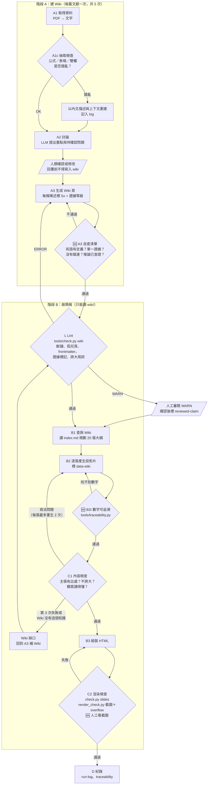
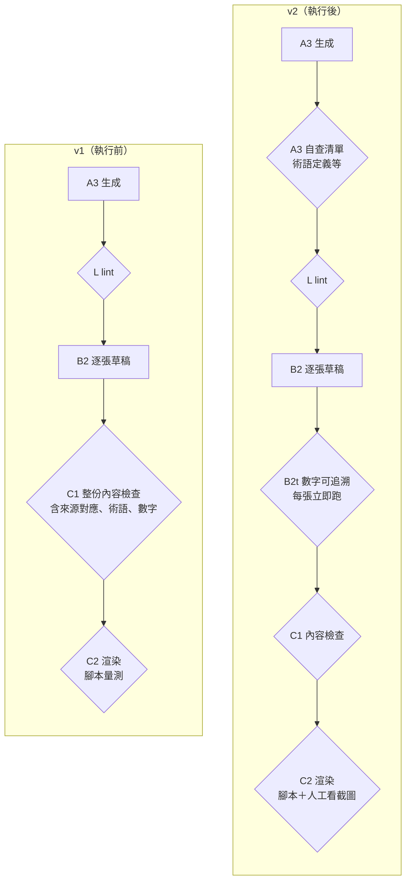

# Loop / Graph 設計

> 作業步驟三。流程的權威版本是 [`CLAUDE.md`](../CLAUDE.md)（LLM 實際照著執行的 schema）；這份是給人讀的說明。
> 本流程跑了一次完整執行（v1），執行後依檢查紀錄修改成 v2，修改原因見 [reflection.md](reflection.md)。

## 1. 流程圖（v2，目前版本）

GitHub 會直接把下面的 Mermaid 渲染成圖。標 🆕 的是 v2 新增或移動的部分。

## 2. v1 → v2 差異

| 檢查項目 | v1 在哪裡 | v2 在哪裡 | 為什麼移動 |
|---|---|---|---|
| 投影片上的數字找得到出處嗎？ | C1（20 張全部寫完後） | **B2t（每張寫完立刻）** | 第 13、20 張的出處漏列，都是在 C1 才發現，已經寫完 20 張，回頭改成本高 |
| 術語在 Wiki 有沒有定義？ | C1（簡報可讀性檢查時才發現） | **A3 自查清單（寫 Wiki 時）** | 「譜聚類」「圖同構」的缺口源頭在 S1 ingest，卻到簡報階段才發現，要走 Wiki 缺口迴圈回頭補 |
| 一條陳述只能有一種證據 | lint 只數標籤個數 | **A3 自查清單** | lint 抓不到「作者的數據＋我的判斷」混成一條 |
| 版面可讀性 | 腳本量測 overflow | **腳本＋人工看截圖** | 6 個版面問題中，腳本只抓到 1 個 |

## 3. 節點說明

| 節點 | 輸入 | 輸出 | 誰做 | 檢查方式 |
|---|---|---|---|---|
| A1 取得 | PDF | 純文字 | LLM（`pdftotext -layout`） | — |
| A1c 抽取檢查 | 純文字 | 錯亂處清單 | LLM 人工判讀 | 公式、表格、雙欄 |
| A2 討論 | 純文字 | 討論底稿（重點＋問題） | LLM | — |
| A2h 人類確認 | 底稿 | 裁決 | **人類** | — |
| A3 生成 | 底稿＋裁決＋原文 | Wiki 頁 | LLM | A3 自查清單（v2） |
| L Lint | `wiki/` | 檢查報告 | `tools/check.py wiki` ＋ LLM 人工 | 自動＋人工 |
| B1 規劃 | `wiki/index.md` | 20 張大綱 | LLM | — |
| B2 草稿 | Wiki 頁 | 投影片 HTML | LLM | B2t 數字可追溯（v2） |
| C1 內容檢查 | 投影片＋Wiki | 問題清單 | LLM 人工比對 | 出處、誇大、可讀性 |
| C2 渲染檢查 | `slides/index.html` | 截圖＋報告 | `check.py slides`、`render_check.py` ＋ 人工 | 自動＋人工 |

## 4. 作業要求的三個問題

### 哪些步驟會重複執行？

| 迴圈 | 範圍 | 這次實際跑了幾次 | 為什麼要重複 |
|---|---|---|---|
| Ingest 迴圈 | A1 → A3 → L | 5 次（每篇一次） | LLM Wiki 會累積：後面的文獻會更新前面建的頁面（例如 ingest S5 時更新了 S1–S3 建立的 9 頁） |
| Lint 修正迴圈 | A3 ↔ L | S1 2 輪、S2 1 輪、S3 2 輪、S4 1 輪、S5 4 輪 | 提前連到還沒建立的頁面、孤兒頁、誇大用詞誤報 |
| 投影片重生迴圈 | B2 ↔ C1 | 第 13、20 張各重生 1 次 | 出處標註不完整 |
| Wiki 缺口迴圈 | C1 → A3 → L → B2 | 1 次（第 10 張的譜聚類、圖同構） | 簡報需要的知識 Wiki 沒有，**先補 Wiki 再改投影片**，不讓 LLM 在投影片上自己編 |
| 渲染迴圈 | B3 ↔ C2 | 7 次執行（其中 2 次是修正渲染腳本本身） | 版面問題、檢查工具本身的 bug |

### 哪些地方需要檢查或重新生成？

1. **A1c 抽取**：5 篇裡有 4 篇的 PDF 抽取有問題（公式拆散、雙欄交錯、字型缺失、段落重複）。
2. **A3 自查與 L lint**：Wiki 層級的一致性與證據標記。
3. **B2t／C1**：簡報內容是否對得上 Wiki、有沒有誇大、聽眾讀不讀得懂。
4. **C2**：HTML 是否正確顯示。
5. **重新生成的規則**：投影片每張最多重生 2 次；第 3 次失敗，或問題根源是 Wiki 沒有這個知識，就走 Wiki 缺口迴圈。

### 為什麼這樣設計？

1. **簡報階段只讀 Wiki**：讓每一句話都能回答「出處是哪一頁」。這是作業「Wiki 與簡報有明確對應」的核心，也讓檢查有明確的答案。
2. **證據等級一開始就放進 Wiki**：這次執行中，討論底稿裡標成「推論」的 S2 分類，在 ingest S5 時被優先查證，發現是錯的並修正。標籤讓「該查哪裡」變得明確。
3. **Wiki 缺口要回寫 Wiki**：這是 LLM Wiki 和「直接讓 LLM 寫簡報」的差別。補進 Wiki 的定義下次查詢還能用，而且也經過 lint。
4. **自動檢查＋人工檢查並用**：腳本適合檢查「有沒有」（連結、標籤、數字），人工適合檢查「對不對」（語意、否定語氣、版面好不好讀）。這次執行證明兩者缺一不可，例子見 [run-log.md](run-log.md)。
5. **重生設上限**：避免 LLM 在同一個錯誤上空轉。
